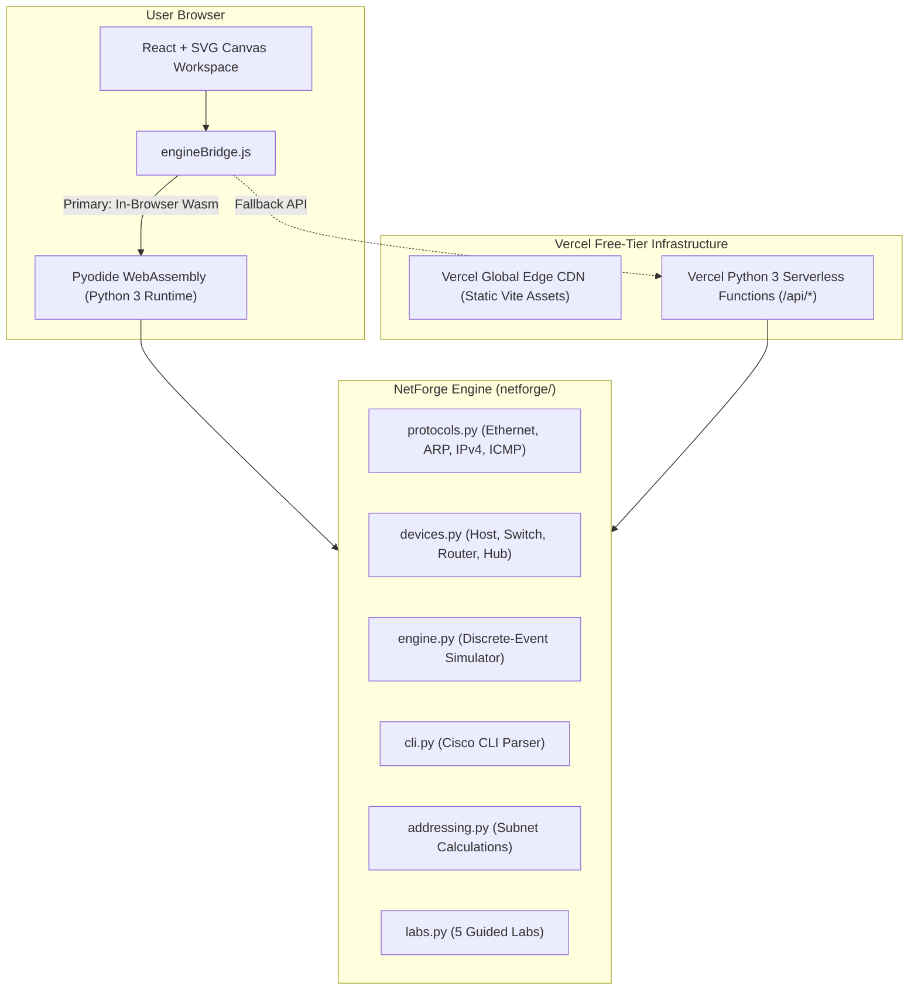
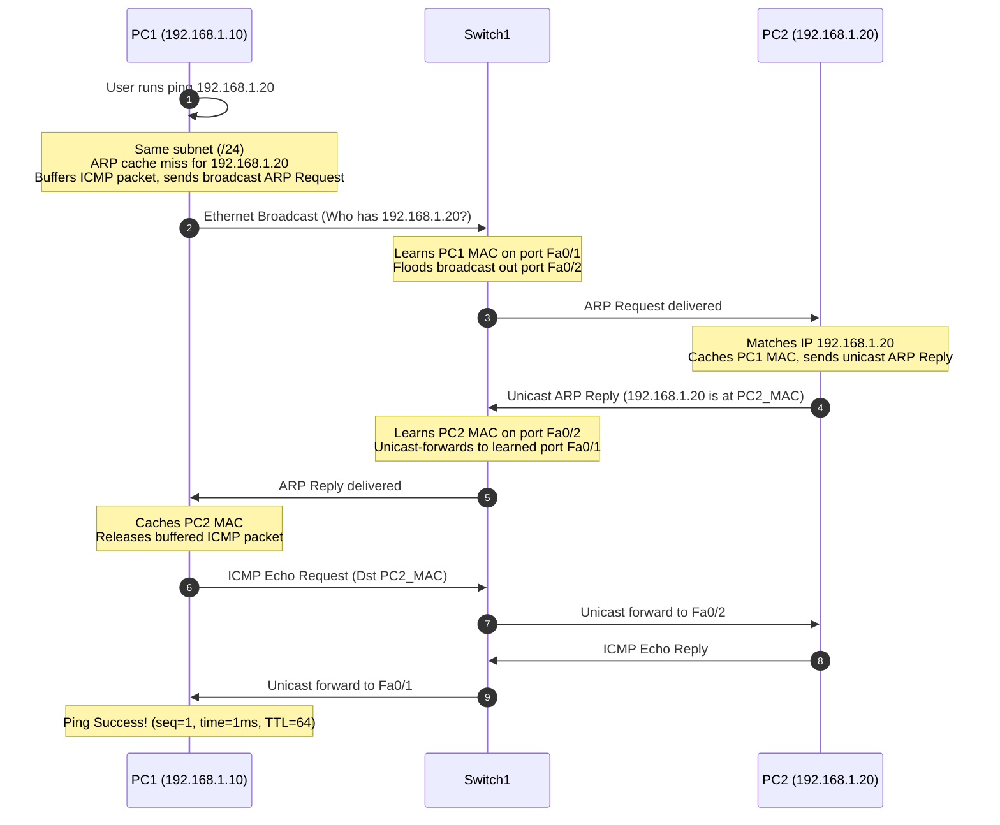

# NetForge — Interactive Network Simulator

[](https://github.com/GorillaBrain/netforge-network-simulator)
[](https://netforge-network-simulator.vercel.app)
[](LICENSE)
[](https://github.com/GorillaBrain/netforge-network-simulator)
[](https://github.com/GorillaBrain/netforge-network-simulator)

> **Live Deployment:** [https://netforge-network-simulator.vercel.app](https://netforge-network-simulator.vercel.app)
> 
> A polished, interactive, educational network simulator inspired by **Cisco Packet Tracer**. Build virtual network topologies, configure devices, simulate packets step-by-step, inspect protocol headers, troubleshoot connectivity, and learn networking through observable simulation.

---

## 🌟 Product Vision

NetForge is an educational networking laboratory where every packet animation, terminal command output, and routing decision is derived directly from genuine protocol logic and state machines.

- **Drag-and-Drop Network Workspace:** Place PCs, Laptops, Ethernet Switches, Routers, Servers, and Hubs on a canvas.
- **Virtual Links & Interface States:** Connect device interfaces with virtual Ethernet cables with link state, delay, and administrative shutdown support.
- **Layer 2 Ethernet Switching:** Source MAC address learning, forwarding table lookup, unicast forwarding, broadcast flooding, unknown unicast flooding, and same-port filtering.
- **Address Resolution Protocol (ARP):** Broadcast ARP Requests, unicast ARP Replies, dynamic ARP cache learning, and ARP wait buffering.
- **Layer 3 IPv4 Routing:** Longest-Prefix-Match (LPM) route lookup, directly connected networks ("C"), static routes ("S"), default routes ("S*"), TTL decrement, and ICMP error generation.
- **Simulated Cisco CLI:** Interactive terminal supporting EXEC and configuration modes (`ping`, `traceroute`, `show ip`, `show interfaces`, `show arp`, `show mac address-table`, `show ip route`, `conf t`, `ip address`, `shutdown`, `no shutdown`, `ip route`).
- **Interactive Packet Inspector:** Deep protocol layer inspection (Ethernet, ARP, IPv4, ICMP) with plain-English pedagogical explanations for each hop.
- **Subnet Calculator & IP Planner:** Bitwise calculations, usable host ranges, binary visualization, RFC 3021 /31 point-to-point links, and same-subnet verification.
- **5 Guided Networking Labs:** Hands-on labs with starting topologies, tasks, hints, and automated evaluation against live simulator state.
- **Save & Load:** Export and import topologies as versioned JSON with schema validation.

---

## 🏗️ Architecture

NetForge combines a **modular, deterministic Python 3 simulation engine** with an interactive **React canvas**:



---

## 📦 Packet Journey Flow



---

## 🚀 Quick Start

### Prerequisites
- Python 3.10+ (for test suite and local CLI)
- Node.js 18+ (for frontend)

### Installation
```bash
# Clone the repository
git clone https://github.com/GorillaBrain/netforge-network-simulator.git
cd netforge-network-simulator

# Install frontend dependencies
npm install

# Run the test suite
python -m pytest -v

# Run the local Vite dev server
npm run dev
```

Visit `http://localhost:3000` in your browser.

---

## 🧪 Testing & Verification

The Python simulation engine is verified by 28 automated tests covering protocol logic, switching rules, routing algorithms, CLI parsing, and guided lab evaluations:

```bash
python -m pytest -v
```

```text
============================= test session starts =============================
collected 28 items

tests/test_addressing.py::test_ip_conversion PASSED                      [  3%]
tests/test_addressing.py::test_invalid_ip PASSED                         [  7%]
tests/test_addressing.py::test_mask_conversion PASSED                    [ 10%]
tests/test_addressing.py::test_invalid_mask PASSED                       [ 14%]
tests/test_addressing.py::test_same_subnet PASSED                        [ 17%]
tests/test_addressing.py::test_subnet_calculator_standard PASSED         [ 21%]
tests/test_addressing.py::test_subnet_calculator_edge_cases PASSED       [ 25%]
tests/test_arp.py::test_arp_resolution_between_two_pcs PASSED            [ 28%]
tests/test_cli.py::test_cli_show_and_config PASSED                       [ 32%]
tests/test_cli.py::test_router_cisco_mode_cli PASSED                     [ 35%]
tests/test_icmp_simulation.py::test_cross_subnet_ping_through_router PASSED [ 39%]
tests/test_icmp_simulation.py::test_missing_default_gateway_failure PASSED [ 42%]
tests/test_icmp_simulation.py::test_interface_down_failure PASSED        [ 46%]
tests/test_labs.py::test_lab_1_workflow PASSED                           [ 50%]
tests/test_labs.py::test_lab_2_workflow PASSED                           [ 53%]
tests/test_labs.py::test_lab_3_workflow PASSED                           [ 57%]
tests/test_labs.py::test_lab_4_troubleshoot_workflow PASSED              [ 60%]
tests/test_labs.py::test_lab_5_workflow PASSED                           [ 64%]
tests/test_protocols.py::test_arp_packet_dict PASSED                     [ 67%]
tests/test_protocols.py::test_icmp_packet_dict PASSED                    [ 71%]
tests/test_protocols.py::test_ethernet_frame_nested PASSED               [ 75%]
tests/test_routing.py::test_longest_prefix_match PASSED                  [ 78%]
tests/test_switching.py::test_mac_learning_and_unicast PASSED            [ 82%]
tests/test_switching.py::test_mac_unknown_unicast_flood PASSED           [ 85%]
tests/test_switching.py::test_mac_broadcast_flood PASSED                 [ 89%]
tests/test_switching.py::test_mac_same_port_filter PASSED                [ 92%]
tests/test_topology.py::test_topology_serialization_and_validation PASSED [ 96%]
tests/test_topology.py::test_duplicate_ip_detection PASSED               [100%]

============================= 28 passed in 0.10s ==============================
```

---

## 📚 Documentation

Comprehensive architectural and engineering documentation is provided in the `docs/` folder:
- [Architecture & Systems Design](docs/ARCHITECTURE.md)
- [Networking & Device Models](docs/NETWORKING_MODEL.md)
- [Protocol Specifications](docs/PROTOCOLS.md)
- [Cisco CLI Command Reference](docs/CLI_REFERENCE.md)
- [Deployment Guide](docs/DEPLOYMENT.md)
- [Testing & Quality Assurance](docs/TESTING.md)

---

## 📄 License

This project is licensed under the [MIT License](LICENSE).
NetForge was built for computer networking education and systems simulation.
