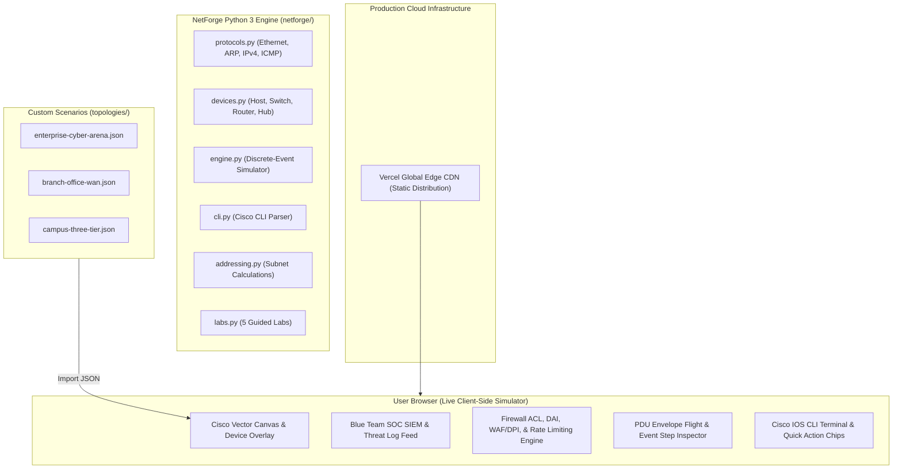
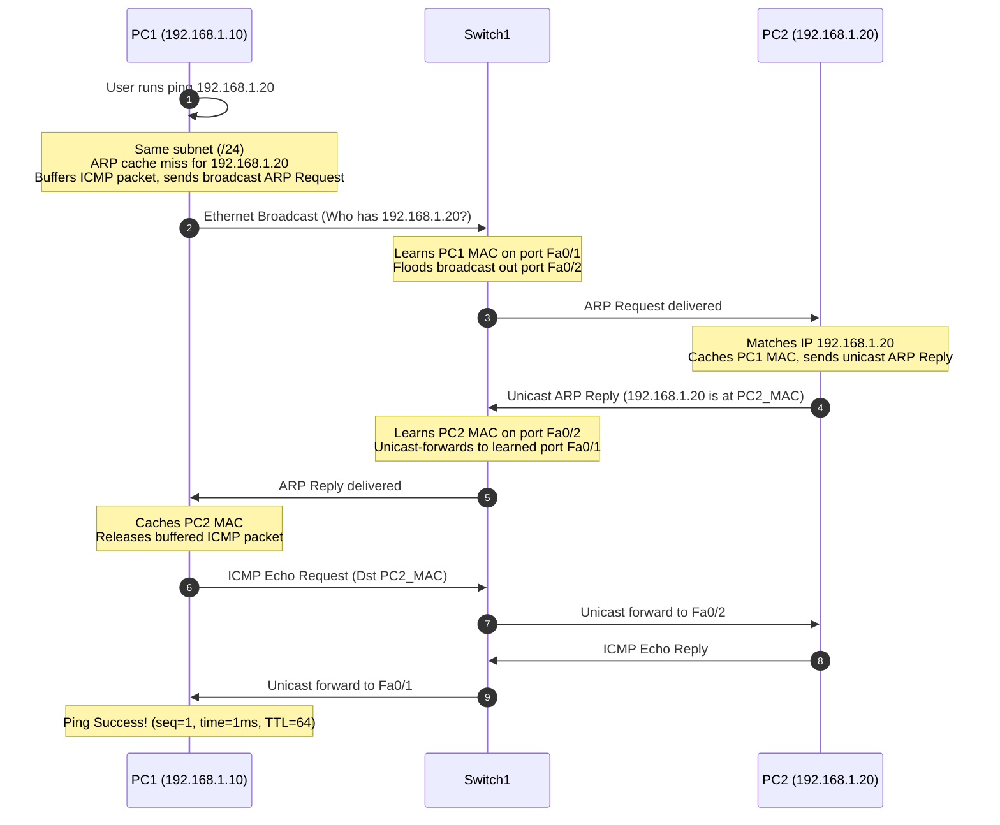

# NetForge: Cyber Defense — Gamified Network & Security Simulator

[](https://github.com/GorillaBrain/netforge-network-simulator)
[](https://github.com/GorillaBrain/netforge-network-simulator/tree/main/topologies)
[](https://netforge-network-simulator.vercel.app)
[](LICENSE)
[](https://netforge-network-simulator.vercel.app)

> **Live Production Deployment:** [https://netforge-network-simulator.vercel.app](https://netforge-network-simulator.vercel.app)
> 
> An interactive, gamified network and cybersecurity simulator inspired by **Cisco Packet Tracer** and modern **Blue-Team SOC SIEMs**. Build virtual network topologies, configure devices, fire simulated cyber attacks, configure firewall ACLs, observe packet travels with flying PDU envelopes, and level up your cybersecurity operator rank.

---

## 🌟 Product Capabilities

NetForge Cyber Defense combines Cisco networking fundamentals with hands-on Blue-Team cybersecurity operations:

- **Iconic Cisco Hardware Canvas:** Authentic vector Cisco Routers (4-way arrows), 2960 Switches, PCs, Laptops, Servers, and Hubs with triangular green/red port link LEDs (▲ / ▼).
- **Simple PDU (Ping) & Exploit Tools:** Click-to-send ICMP pings and fire simulated Red Team payloads (Nmap SYN scan, SSH brute-force, SQL injection, Botnet DDoS SYN flood, and Gratuitous ARP MITM).
- **Blue-Team SOC SIEM & Defense:** Live SIEM log feed with severity indicators, Firewall ACL rule builder, Deep Packet Inspection (DPI/WAF), Rate Limiting, and Dynamic ARP Inspection (DAI).
- **8 Gamified Campaign Missions:**
  - *M01: First LAN & ARP Discovery* (Beginner)
  - *M02: Subnet Mask Forensics /25 vs /24* (Beginner)
  - *M03: Cross-Subnet Router Gateway* (Intermediate)
  - *M04: Multi-Layer Outage Triage* (Intermediate)
  - *M05: L2/L3 MAC Re-Encapsulation Trace* (Advanced)
  - *M06: Operation Iron Gate — Firewall ACL & SSH Defense* (CyberSec)
  - *M07: Operation Poison Ivy — Defeat ARP Spoofing MITM* (CyberSec)
  - *M08: Operation Blackout — DDoS SYN Flood & SQLi WAF Defense* (Boss)
- **Cisco IOS CLI & Desktop Console:** Interactive terminal supporting EXEC and configuration modes, command history, and one-click quick action chips.
- **Subnet Planning & CIDR Matrix:** Bitwise subnet calculations, usable host ranges, binary visualization, and same-subnet verification.
- **Topology Import & Export:** One-click JSON export and import supporting custom community scenarios.
- **Operator Rank & Achievement Badges:** Level up from Trainee to Autonomous NetGod with XP toasts, sound effects, and celebratory fanfare.

---

## 🏗️ Architecture

NetForge combines a **modular, deterministic Python 3 simulation engine** with an interactive **high-performance browser simulator**:



---

## 📦 Packet Journey Flow



---

## 🗂️ Pre-Built Topologies

NetForge ships with validated pre-built network topologies ready to import into the simulator:

| Topology File | Description | Devices |
| :--- | :--- | :--- |
| [**`topologies/enterprise-cyber-arena.json`**](topologies/enterprise-cyber-arena.json) | Multi-tier enterprise network with ASA Firewall, DMZ Web Server, Internal DB, Admin PC, and Kali Attacker | 6 devices, 5 links |
| [**`topologies/branch-office-wan.json`**](topologies/branch-office-wan.json) | Two corporate branch locations interconnected via edge routers with static IP routing | 6 devices, 5 links |
| [**`topologies/campus-three-tier.json`**](topologies/campus-three-tier.json) | Cisco 3-tier campus network (Core Router, Distribution Switch, Access Switches, PCs, DNS Server) | 7 devices, 6 links |

---

## 🚀 Quick Start

### Prerequisites
- Python 3.10+ (for test suite and local Python simulation engine)
- Node.js 18+ (for local development server and topology verification)

### Installation
```bash
# Clone the repository
git clone https://github.com/GorillaBrain/netforge-network-simulator.git
cd netforge-network-simulator

# Install dependencies
npm install

# Run the full test suite (pytest + topology validator)
npm test

# Run the local Vite dev server
npm run dev
```

Visit `http://localhost:3000` in your browser.

---

## 🧪 Testing & Verification

NetForge includes dual verification suites:

### 1. Python Simulation Engine Tests (28 tests)
```bash
python -m pytest -v
```

```text
============================= test session starts =============================
collected 28 items

tests/test_addressing.py::test_ip_conversion PASSED                      [  3%]
tests/test_addressing.py::test_invalid_ip PASSED                         [  7%]
tests/test_addressing.py::test_mask_conversion PASSED                    [ 10%]
tests/test_addressing.py::test_invalid_mask PASSED                       [ 14%]
tests/test_addressing.py::test_same_subnet PASSED                        [ 17%]
tests/test_addressing.py::test_subnet_calculator_standard PASSED         [ 21%]
tests/test_addressing.py::test_subnet_calculator_edge_cases PASSED       [ 25%]
tests/test_arp.py::test_arp_resolution_between_two_pcs PASSED            [ 28%]
tests/test_cli.py::test_cli_show_and_config PASSED                       [ 32%]
tests/test_cli.py::test_router_cisco_mode_cli PASSED                     [ 35%]
tests/test_icmp_simulation.py::test_cross_subnet_ping_through_router PASSED [ 39%]
tests/test_icmp_simulation.py::test_missing_default_gateway_failure PASSED [ 42%]
tests/test_icmp_simulation.py::test_interface_down_failure PASSED        [ 46%]
tests/test_labs.py::test_lab_1_workflow PASSED                           [ 50%]
tests/test_labs.py::test_lab_2_workflow PASSED                           [ 53%]
tests/test_labs.py::test_lab_3_workflow PASSED                           [ 57%]
tests/test_labs.py::test_lab_4_troubleshoot_workflow PASSED              [ 60%]
tests/test_labs.py::test_lab_5_workflow PASSED                           [ 64%]
tests/test_protocols.py::test_arp_packet_dict PASSED                     [ 67%]
tests/test_protocols.py::test_icmp_packet_dict PASSED                    [ 71%]
tests/test_protocols.py::test_ethernet_frame_nested PASSED               [ 75%]
tests/test_routing.py::test_longest_prefix_match PASSED                  [ 78%]
tests/test_switching.py::test_mac_learning_and_unicast PASSED            [ 82%]
tests/test_switching.py::test_mac_unknown_unicast_flood PASSED           [ 85%]
tests/test_switching.py::test_mac_broadcast_flood PASSED                 [ 89%]
tests/test_switching.py::test_mac_same_port_filter PASSED                [ 92%]
tests/test_topology.py::test_topology_serialization_and_validation PASSED [ 96%]
tests/test_topology.py::test_duplicate_ip_detection PASSED               [100%]

============================= 28 passed in 0.10s ==============================
```

### 2. Topology Schema Validator
```bash
npm run validate
```

```text
🔍 NetForge Topology Schema Validator
Scanning: topologies

✅ branch-office-wan.json: Valid (6 devices, 5 links) — "Branch Office WAN Routing Topology"
✅ campus-three-tier.json: Valid (7 devices, 6 links) — "Cisco 3-Tier Campus Network (Core, Dist, Access)"
✅ enterprise-cyber-arena.json: Valid (6 devices, 5 links) — "Enterprise Cyber Defense Arena (DMZ + Core)"

🎉 All topology schemas verified successfully!
```

---

## 📚 Documentation

Comprehensive architectural and engineering documentation is provided in the `docs/` folder:
- [Cyber Defense Operations Manual (SOC & Blue Team Guide)](docs/CYBER_DEFENSE_OPS.md)
- [Topology Schema & Custom Lab Authoring](docs/TOPOLOGY_SCHEMA.md)
- [Architecture & Systems Design](docs/ARCHITECTURE.md)
- [Networking & Device Models](docs/NETWORKING_MODEL.md)
- [Protocol Specifications](docs/PROTOCOLS.md)
- [Cisco CLI Command Reference](docs/CLI_REFERENCE.md)
- [Deployment Guide](docs/DEPLOYMENT.md)
- [Testing & Quality Assurance](docs/TESTING.md)

---

## 📄 License

This project is licensed under the [MIT License](LICENSE).
NetForge was built for computer networking education and systems simulation.
