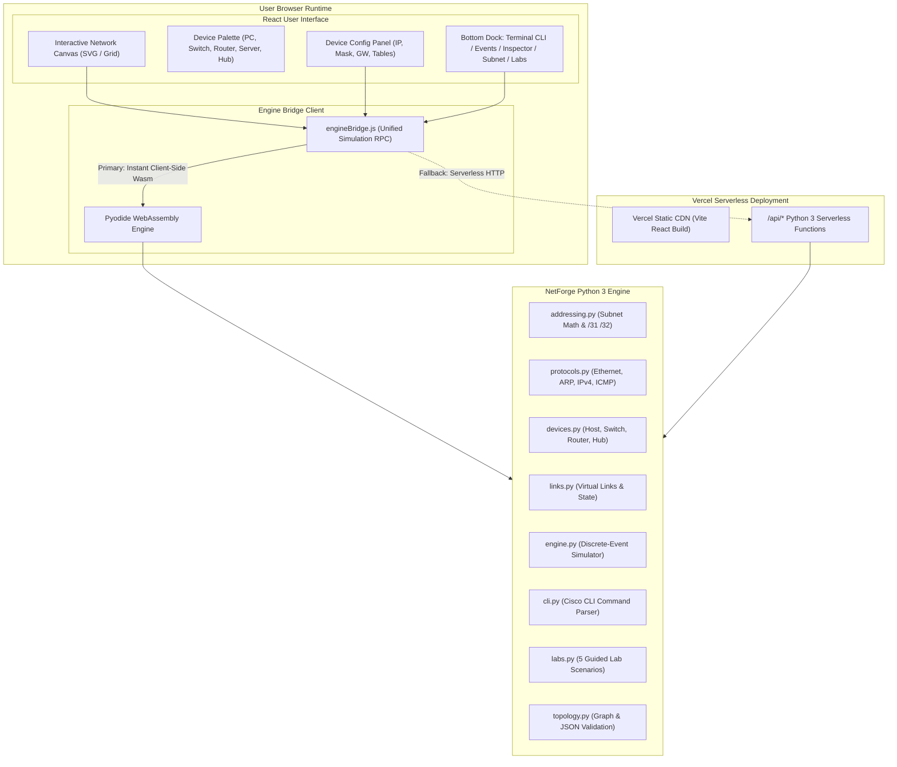

# NetForge Architecture

NetForge is an interactive, educational network simulator inspired by Cisco Packet Tracer.
It models real networking devices, physical links, Ethernet frames, ARP resolution, Layer 2 switching, IPv4 routing, and ICMP messaging through deterministic, observable simulation events.

---

## 1. System Architecture Overview



---

## 2. Simulated Packet Journey Sequence

The following Mermaid sequence diagram illustrates an end-to-end packet transmission between hosts on different subnets connected by a router:

```mermaid
sequenceDiagram
    autonumber
    actor User
    participant PC1 as PC1 (192.168.10.10)
    participant SW1 as Switch 1
    participant R1 as Router 1 (Gi0/0: .10.1, Gi0/1: .20.1)
    participant SW2 as Switch 2
    participant PC2 as PC2 (192.168.20.20)

    User->>PC1: Execute `ping 192.168.20.20`
    Note over PC1: 192.168.20.20 is outside local subnet (/24).<br/>Target is Default Gateway: 192.168.10.1
    Note over PC1: ARP Cache Miss for 192.168.10.1.<br/>Buffers ICMP packet; sends broadcast ARP Request.

    PC1->>SW1: Ethernet Broadcast: Who has 192.168.10.1?
    Note over SW1: Learns PC1 MAC on port Fa0/1.<br/>Floods broadcast out port Fa0/2.
    SW1->>R1: Forward ARP Request to Gi0/0

    Note over R1: Gi0/0 matches target IP 192.168.10.1!<br/>Caches PC1 MAC; replies with unicast ARP Reply.
    R1->>SW1: Unicast ARP Reply (192.168.10.1 is at R1_MAC)
    Note over SW1: Learns R1 MAC on port Fa0/2.<br/>Unicast-forwards to learned port Fa0/1.
    SW1->>PC1: Deliver ARP Reply to PC1

    Note over PC1: PC1 updates ARP cache.<br/>Drains buffer & sends ICMP Echo Request.
    PC1->>SW1: Unicast IPv4 ICMP Echo Request (Dst: R1_MAC)
    SW1->>R1: Forward frame to Router Gi0/0

    Note over R1: R1 decapsulates frame.<br/>Decrements IPv4 TTL: 64 -> 63.<br/>Longest Prefix Match lookup matches 192.168.20.0/24 on Gi0/1.<br/>Next hop is PC2 (192.168.20.20).
    Note over R1: ARP Cache Miss for 192.168.20.20.<br/>Buffers ICMP packet; broadcasts ARP Request on Gi0/1.

    R1->>SW2: Broadcast ARP Request: Who has 192.168.20.20?
    SW2->>PC2: Flood ARP Request to PC2
    Note over PC2: Matches my IP! Sends ARP Reply.
    PC2->>SW2: Unicast ARP Reply (192.168.20.20 is at PC2_MAC)
    SW2->>R1: Forward ARP Reply to Router Gi0/1

    Note over R1: R1 caches PC2 MAC.<br/>Re-encapsulates buffered ICMP packet with PC2_MAC.<br/>Transmits out Gi0/1.
    R1->>SW2: Unicast IPv4 ICMP Echo Request
    SW2->>PC2: Deliver to PC2

    Note over PC2: Validates Echo Request; generates ICMP Echo Reply.<br/>Sends back to Default Gateway (R1).
    PC2->>SW2: ICMP Echo Reply
    SW2->>R1: Forward to Router Gi0/1
    Note over R1: Decrements TTL: 64 -> 63.<br/>Routes back to 192.168.10.10 via Gi0/0.
    R1->>SW1: ICMP Echo Reply
    SW1->>PC1: Deliver Echo Reply to PC1
    Note over PC1: ICMP Echo Reply Received!<br/>Round-Trip Complete (TTL=63).
```

---

## 3. Technology Selection & Trade-Offs

| Requirement | Design Decision | Rationale |
| :--- | :--- | :--- |
| **Simulation Fidelity** | Pure Python 3 Engine (`netforge/`) | Allows exact bitwise arithmetic, protocol object graphs, and comprehensive unit testing via `pytest`. |
| **Free Production Hosting** | Pyodide WebAssembly (Client-Side) | Runs 100% in-browser with zero latency, offline capability, and zero compute costs on Vercel free tier. |
| **API Fallback** | Vercel Serverless Functions (`api/*.py`) | Provides headless API access and automated backup if WebAssembly is unavailable in restricted environments. |
| **Canvas UX** | React + SVG Graph Layout | Crisp rendering of devices, links, animated traffic flows, and responsive viewport zoom/pan controls. |
